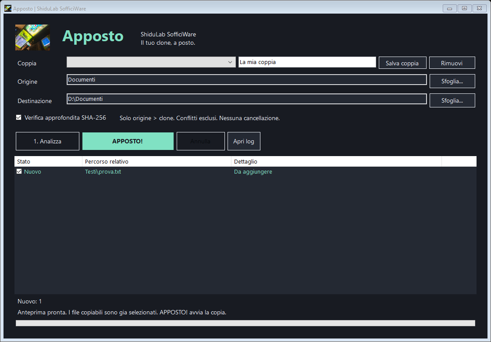
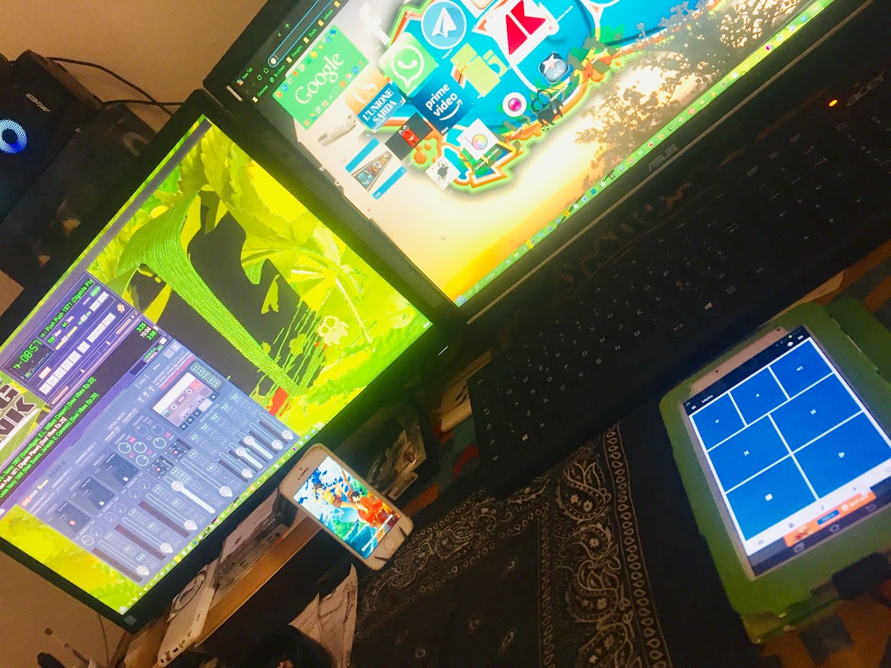

# Apposto

### Il tuo clone, a posto.

**ShiduLab SofficiWare**

[Scarica la versione portatile](https://github.com/ShiduLab/Apposto/releases/latest) · [Guida e protezioni](LEGGIMI.md) · [Rapporti di prova](verifiche)



La foto della postazione ShiduLab accompagna Apposto nell'intestazione e nell'icona Windows, ricavata dalla stessa immagine in sette dimensioni.

Hai una cartella sul PC. In un altro disco o in un'altra cartella ne hai una copia. Nel frattempo hai scritto, corretto, aggiunto file in venti sottocartelle diverse.

Apposto nasce per togliere di mezzo una domanda noiosa: quali file devo portare dall'altra parte?

Gli indichi una volta l'origine e il clone. Lui percorre gli alberi, confronta i file e prepara tutti quelli da aggiungere o aggiornare, gia selezionati e con il percorso corretto. Tu guardi l'anteprima e premi **APPOSTO!**

La parte soffice e questa: meno caccia ai file, meno gesti ripetuti, piu attenzione a quello che stavi facendo.

<details>
<summary>La foto originale della postazione ShiduLab</summary>



</details>

## Un compito preciso

```text
PC / Testi                       USB / Testi
  romanzo/capitolo-3.docx   >       romanzo/capitolo-3.docx
  appunti/idea.txt          >       appunti/idea.txt
  lavoro/bozza.md           >       lavoro/bozza.md
```

I file possono stare in sottocartelle diverse. Apposto ricostruisce la gerarchia senza appiattirla e conserva nomi e data di ultima modifica.

Il flusso segue una direzione: **origine > clone**. I file presenti soltanto nel clone rimangono al loro posto. Se il clone contiene una versione diversa con data uguale o piu recente, Apposto la segnala come conflitto e la esclude dal piano.

## Prima guardi. Poi metti a posto.

1. Premi Sfoglia...: si apre Questo PC, dove puoi scegliere un disco intero o una cartella per Origine e Destinazione. Salva la coppia con un nome.
2. Analizza, oppure richiama una coppia gia salvata.
3. Guarda nuovi, aggiornati, uguali, file solo destinazione, conflitti ed errori.
4. Premi **APPOSTO!** per copiare tutti i file predisposti.

La selezione automatica e il punto di partenza. Puoi togliere singoli file dal piano, ma non devi cercarli e aggiungerli a mano. I conflitti richiedono una valutazione separata: questa versione non offre un pulsante per sovrascriverli forzatamente.

## La prudenza fa parte del prodotto

| Situazione | Comportamento |
| --- | --- |
| File nuovo nell'origine | Gia selezionato per la copia |
| Origine piu recente, contenuto diverso | Gia selezionato, con storico della versione sostituita |
| Contenuto identico, metadati diversi | Nessuna copia dopo verifica hash |
| Clone diverso con data uguale o piu recente | Conflitto, escluso |
| File solo nel clone | Conservato |
| File non leggibile | Segnalato, senza interrompere l'intera analisi |
| Link o junction | Escluso, senza seguirlo |
| Origine e clone contenuti uno nell'altro | Operazione rifiutata |
| File cambiato dopo l'anteprima | Piano bloccato per quel file |

Ogni sostituzione conserva la versione precedente sotto `.apposto/storico`. La copia passa attraverso un temporaneo nella directory finale, viene verificata con SHA-256 e poi rinominata. Per una sostituzione viene usato `File.Replace` con backup: se il filesystem non lo consente viene riportato un errore, senza ripiegare su una sovrascrittura senza storico.

Il confronto rapido usa percorsi relativi, dimensioni e timestamp. La verifica approfondita SHA-256 permette di controllare anche file che hanno dimensione e data identiche. Quando i metadati differiscono, il contenuto viene comunque confrontato prima di proporre una sostituzione.

## Portatile, sul serio

App desktop WinForms per Windows 10/11. Nessun browser necessario per usarla, nessun servizio, nessun account e nessuna installazione. Richiede .NET Framework 4.5 o successivo, normalmente gia presente su Windows 10/11.

Estrai l'intera cartella in una posizione scrivibile e avvia **Apposto.exe**. Coppie e log vengono conservati nella cartella `Dati` accanto all'app. Spostando tutta la cartella porti con te anche le impostazioni.

Le coppie registrano l'identita del volume Windows. Quando richiami una coppia, Apposto puo ritrovare lo stesso disco su un'altra lettera. Se il disco e assente o l'identita non coincide, l'app si ferma e lo segnala.

## Prima versione funzionante: 0.1

La prima consegna comprende eseguibile, sorgenti, procedura di compilazione, test e rapporti. Il motore e stato provato su fixture reali con file nuovi e modificati, sottocartelle, contenuti uguali, file solo destinazione, conflitti, file bloccati e junction. Sono stati verificati anche storico, timestamp, piano obsoleto e annullamento durante copia.

**30 verifiche del motore superate**, oltre al test del flusso asincrono dell'interfaccia: avvio, scansione, piano preselezionato, copia e seconda scansione senza altre copie da eseguire. Rapporti e schermata sono in [`verifiche`](verifiche).

Compilazione e prove eseguite su Windows, build 19045. Windows 11, cambio lettera su USB fisica e comportamento sui diversi filesystem esterni richiedono ancora collaudo dedicato. Il recupero del volume e implementato, ma non viene presentato come gia provato su una periferica reale.

## Limiti dichiarati

La versione 0.1 copia i dati principali dei file e il timestamp di ultima modifica. Non replica directory vuote, ACL, alternate data stream o tutte le proprieta NTFS. Lo storico cresce senza pulizia automatica. I percorsi `.apposto` sono riservati.

La modalita rapida presume uguaglianza se data e dimensione coincidono: per quei casi usa la verifica approfondita quando serve certezza sul contenuto. Una verifica hash gia avviata puo ritardare l'annullamento.

Apposto non usa snapshot VSS. Evita modifiche contemporanee agli alberi durante l'operazione. I controlli contro cambiamenti successivi all'anteprima riducono il rischio, senza garantire isolamento da altri processi o resistenza a guasti hardware e perdita di alimentazione. Dopo un arresto forzato possono restare temporanei separati dai file finali.

L'eseguibile non e firmato digitalmente. Per dettagli su storico, ripristino, percorsi e dischi consulta [`LEGGIMI.md`](LEGGIMI.md).

## Sorgenti essenziali

| File | Compito |
| --- | --- |
| `src/Engine.cs` | Analisi, piano automatico e copia protetta |
| `src/Profiles.cs` | Coppie persistenti e identita dei volumi |
| `src/Program.cs` | Interfaccia italiana e operazioni in background |
| `tests/Tests.cs` | Fixture e verifiche ripetibili |
| `build.ps1` | Compilazione locale e test, senza download di dipendenze |

Per ricompilare su Windows esegui `build.ps1` dalla cartella del progetto. Usa il compilatore .NET Framework presente in Windows e interrompe la procedura se compilazione o test falliscono.

---

**Apposto. Un piccolo attrezzo per lasciare a posto una cosa concreta.**

ShiduLab SofficiWare
